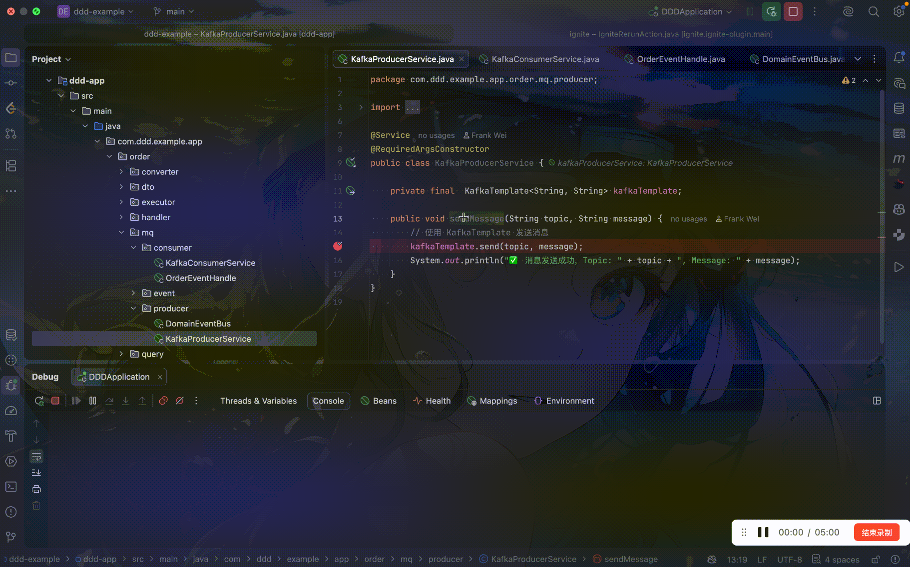
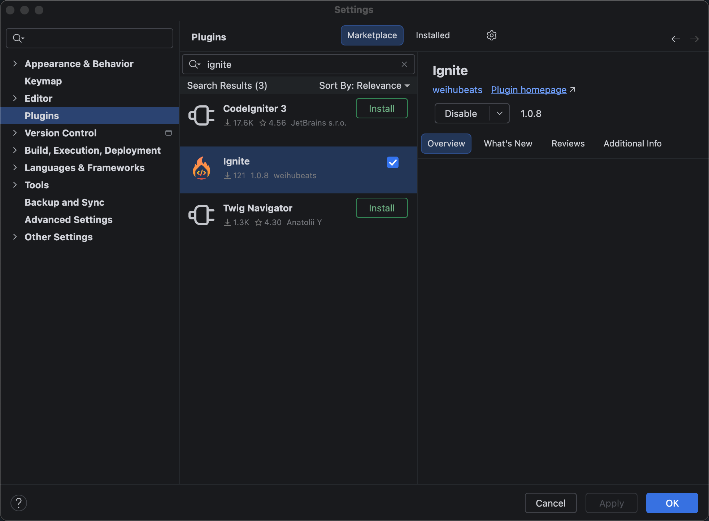

🚀 Ignite Plugin - IntelliJ Arthas Integration
==============================================

**Ignite** 是一款专为 IntelliJ IDEA 设计的开发效能插件。通过右键菜单直接调用运行中进程（Spring Boot/Java 应用）的任意方法。

* * *

✨ 核心特性 (Features)
-----------------

*   **⚡️ 右键即运行 (One-Click Execution)**

    *   直接在 Java 方法名上右键点击 `Ignite Run`，即可触发调用。

    *   自动生成方法的 Mock 入参（基于 DataFaker）。

*   **🛠 微服务/多进程支持 (Microservices Support)**

    *   智能识别所有运行中的 Java 进程。

    *   通过下拉框选择目标服务（显示服务名与 PID），轻松调试多实例环境。

*   **📝 强大的参数编辑器**

    *   内置 JSON 高亮编辑器，支持语法检查与格式化。

    *   **参数记忆功能**：命令执行成功后自动保存本次入参，拒绝重复输入。

* * *

📸 截图预览 (Screenshots)
---------------------

* * *

🛠 安装指南 (Installation)
----------------------

### 插件市场安装

`Plugins` 搜索 `ignite`安装

然后在任意方法上面邮件即可执行

### 从源码构建

1. 克隆本项目：

   Bash

       git clone https://github.com/weihubeats/ignite-plugin.git

2. 使用 Gradle 构建插件包：

   Bash

       ./gradlew clean buildPlugin

3. 构建成功后，在 `build/distributions/` 目录下找到 `ignite-plugin-1.0-SNAPSHOT.zip`。

4. 打开 IDEA -> `Settings` -> `Plugins` -> ⚙️ 图标 -> `Install Plugin from Disk...`，选择该 zip 包安装。

### 从 GitHub Releases 下载

前往 [Releases](https://github.com/weihubeats/ignite/releases) 页面下载最新版本的 zip 包，按上述方式安装。

* * *

🚢 发布流程 (Release)
---------------------

插件通过 CI 自动发布，维护者只需：

1. 同步修改根目录与 `ignite-plugin/build.gradle.kts` 中的 `version`（三处版本必须一致：tag、根构建脚本、子项目构建脚本）；
2. 提交并打 tag：`git tag v1.0.10 && git push origin v1.0.10`；
3. CI 自动完成：版本一致性校验 → 全量测试 → 构建插件 zip → 发布到 GitHub Releases。

> 版本不一致或测试失败时发布会被拦截，不会产生残缺的 Release。

📖 使用说明 (Usage)
---------------

1.  **启动项目**： 在 IDEA 中启动你的 Spring Boot 或 Java 应用程序。

2.  **选择方法**： 打开任意 Java 类，将光标定位在你想测试的**方法名**上。

3.  **触发运行**：

    *   点击鼠标右键，选择菜单中的 **`Ignite Run`**。

    *   _(或者配置快捷键以提高效率)_

4.  **调整参数**：

    *   插件会弹出一个配置窗口。

    *   **目标服务**：在下拉框中选择你要调试的进程（如 `UserService (PID: 8080)`）。

    *   **入参 (JSON)**：编辑方法的入参。插件默认会生成随机 Mock 数据，你可以根据需要修改。

5.  **查看结果**： 点击 `OK`。底部会自动弹出 **Ignite Console** 窗口，显示结构化的执行报告。

* * *

⚙️ 技术原理 (How it works)
----------------------

1. **Attach**: 插件利用 Java Attach API 将 `arthas-boot.jar` 注入到目标 JVM。

2. **Command**: 解析选中的 PSI 方法结构，通过 `vmtool` 命令构建 Ognl 表达式：

   Bash

       vmtool --action getInstances --className com.xxx.Controller --express 'instances[0].method(args)'

3. **Communication**: 通过 Telnet 连接到 Arthas 端口 (3658)，发送指令并解析回包。

4. **Display**: 清洗 Telnet 的原始输出，提取返回值并美化 JSON，通过 ToolWindow 展示。

* * *

🤝 贡献 (Contributing)
--------------------

欢迎提交 Issue 或 Pull Request！ 如果你有好的想法，比如支持更多 Arthas 命令（Trace, Watch 等），请随时联系。

📄 许可证 (License)
----------------

Apache 2.0 License